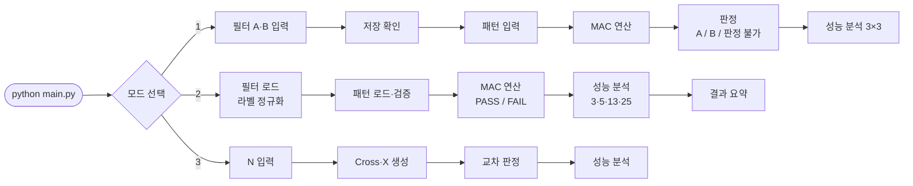
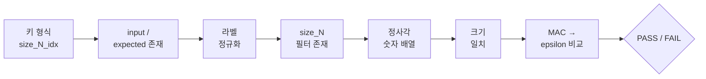
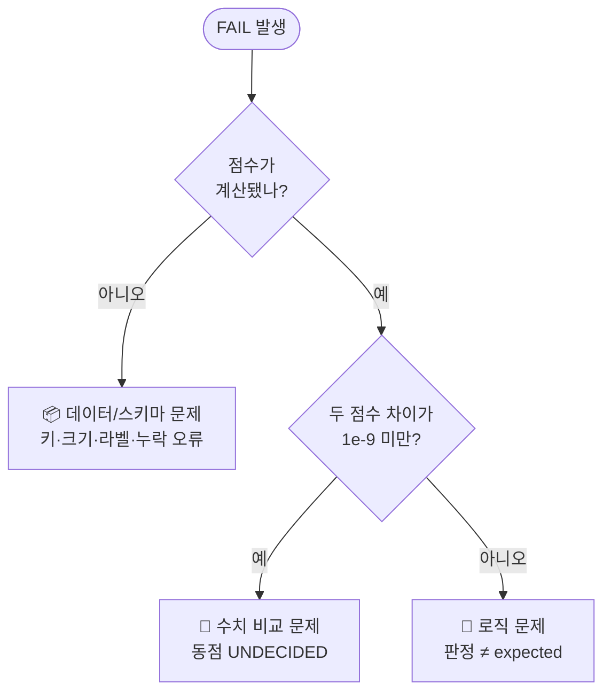

<div align="center">

# 🧠 Mini NPU Simulator

### MAC 연산으로 패턴을 판별하는 미니 신경망 처리 장치 시뮬레이터

*Multiply · Accumulate · Decide*

<br>


-8A2BE2?style=for-the-badge)

<br>

```
   십자가 (Cross)          X
   □ ■ □                ■ □ ■
   ■ ■ ■                □ ■ □
   □ ■ □                ■ □ ■
   0 1 0                1 0 1
   1 1 1                0 1 0
   0 1 0                1 0 1
```

**사람은 한눈에 구별하지만, 컴퓨터는 숫자로만 봅니다.**<br>
패턴과 필터를 같은 위치끼리 곱하고 모두 더하는 **MAC 연산**으로 컴퓨터가 모양을 구별하게 만듭니다.

</div>

<br>

<a id="overview"></a>

## 📌 과제 개요

### 🧭 배경: 왜 이 과제를 하는가?

| 단계 | 내용 |
|:-:|---|
| 🖼️ **문제** | 사람은 십자가와 X를 눈으로 바로 구별하지만, 컴퓨터는 모양을 보지 못하고 **숫자(0과 1, 실수)만** 이해합니다. |
| 🔢 **해결** | 그림을 **2차원 숫자 배열**로 바꾸고, 판별 기준이 되는 모양도 숫자 배열로 정의합니다. 이 기준 배열을 **필터(Filter)** 라고 합니다. |
| ✖️ **방법** | 입력과 필터를 겹쳐 같은 위치끼리 **곱하고(Multiply) 모두 더해(Accumulate)** 유사도 점수를 구합니다. 이것이 **MAC 연산**입니다. |
| ⚡ **한계** | 실제 AI는 수백×수백 크기의 필터를 수천 개 쓰고, 이미지 한 장에 **수억 번의 MAC**이 필요합니다. 순서대로 처리하는 CPU로는 감당하기 어렵습니다. |
| 🧠 **NPU** | 그래서 수천 개의 MAC을 **동시에(병렬)** 처리하는 AI 전용 칩, **NPU(Neural Processing Unit)** 가 만들어졌습니다. |

> 이 과제에서는 MAC 연산의 원리를 직접 코드로 구현해 **3×3부터 25×25까지의 패턴을 판별하는 Mini NPU 시뮬레이터**를 만듭니다.
> 크기에 따라 연산 시간이 어떻게 변하는지 측정하고, 만들면서 생기는 문제(라벨 표기, 부동소수점, 데이터 오류)를 해결합니다.

### 🎯 과제 목표

이 과제를 마치면 아래 내용을 스스로 설명할 수 있어야 합니다. (자세한 정리: [🎯 과제 목표 정리](#goals))

1. **MAC 연산**이 무엇이고 AI에서 왜 중요한지
2. 패턴과 필터를 곱하고 더해 **유사도(점수)** 를 구하는 원리
3. data.json의 **키 규칙 / 라벨 규칙**과 **라벨 정규화**가 필요한 이유
4. **부동소수점 오차**가 판정에 주는 영향과 **epsilon 비교**가 필요한 이유
5. 크기별 연산 시간 측정과 **시간 복잡도 O(N²)** 의 근거
6. 실패 원인을 **데이터/스키마 · 로직 · 수치 비교**로 나눠 진단하고 개선하는 방법

### 📦 최종 결과물

Python 콘솔 애플리케이션 1개로 아래 4가지 기능을 제공합니다.

| 기능 | 입력 / 요청 | 출력 / 화면 | 상태 |
|---|---|---|:-:|
| **사용자 입력 (3×3)** | 3×3 필터 2개(A, B)와 패턴을 콘솔로 입력 | 두 필터의 MAC 점수, 연산 시간(ms), 판정(A / B / 판정 불가) | ✅ |
| **JSON 데이터 분석** | `data.json`의 5×5 · 13×13 · 25×25 필터와 패턴을 불러와 일괄 판정 | 케이스별 판정(Cross / X / UNDECIDED), expected 비교(PASS / FAIL) | ✅ |
| **성능 분석** | 크기별 MAC 연산 시간을 10회 반복 측정 | 크기별 평균 시간(ms)과 연산 횟수(N²) 표 | ✅ |
| **결과 리포트** | 분석 결과 집계 | 콘솔: 총 / 통과 / 실패 수와 실패 목록 · README: 실패 원인 분석 + 시간 복잡도 분석 | ✅ |
| 🎁 보너스 | 2D → 1D 최적화, N×N 패턴 생성기 | 최적화 전/후 성능 비교, Cross / X 자동 생성 | ✅ |

### 🛠️ 개발 환경과 제약

| 항목 | 내용 |
|---|---|
| 언어 | Python 3.8 이상 (개발·테스트: Python 3.11) |
| 라이브러리 | **표준 라이브러리만** 사용 (`json`, `time`, `re`, `math`, `os`, `sys`, `unicodedata`) — NumPy, pandas 사용 금지 |
| MAC 구현 | 벡터화 없이 **반복문으로 직접** 구현 |
| 입력 검증 | 행/열 개수, 숫자 파싱 검증 → 오류 시 안내 후 재입력 |
| 오류 처리 | 스키마 / 크기 불일치가 있어도 **프로그램이 멈추지 않고** 케이스 단위로 FAIL 처리 |
| 점수 비교 | 허용오차 **epsilon(1e-9)** 기준 비교, 동점은 UNDECIDED |

### 📤 제출물

| 파일 | 설명 |
|---|---|
| [`main.py`](main.py) | 메인 실행 파일 (모드 1 · 2 · 3) |
| [`README.md`](README.md) | 실행 방법, 구현 요약, 결과 리포트(실패 원인 분석 + 시간 복잡도 분석) |
| [`data.json`](data.json) | 분석용 데이터 (필터 3종 + 패턴 8개) |
| [`samples/data_invalid.json`](samples/data_invalid.json) | 오류 처리 검증용 데이터 |

### 🏁 결과 한눈에 보기

<div align="center">

| data.json 판정 | 오류 데이터 처리 | 시간 복잡도 | 1D 최적화 |
|:-:|:-:|:-:|:-:|
| **8 / 8 PASS** | **7건 FAIL + 사유 출력**<br>(프로그램 중단 없음) | **O(N²)**<br>(연산 25배 → 시간 약 17배) | **10~37% 단축** |

</div>

<br>

## 📑 목차

| | 섹션 | 내용 |
|:-:|---|---|
| 📌 | [과제 개요](#overview) | 배경, 목표, 최종 결과물, 개발 환경, 제출물 |
| 🎤 | [브리핑 가이드](#briefing) | 최종 결과물 4가지 시연 순서와 발표 포인트 |
| 🚀 | [실행 방법](#run) | 실행 명령, 모드, 파일 구성 |
| ⚙️ | [구현 요약](#implementation) | 데이터 구조, 라벨 정규화, MAC, epsilon 정책 |
| 📊 | [결과 리포트](#report) | 실패 원인 분석 + 시간 복잡도 분석 |
| 🎁 | [보너스 과제](#bonus) | 1D 최적화, 패턴 생성기 |
| ✅ | [재현성 체크리스트](#checklist) | 검증 항목 |
| 🎯 | [과제 목표 정리](#goals) | 학습 목표 6가지를 직접 설명하기 위한 정리 |

<br>

## ✨ 핵심 기능

<table>
<tr>
<td width="50%" valign="top">

### 1️⃣ 사용자 입력 (3×3)
필터 A, B와 패턴을 콘솔로 입력<br>
→ **MAC 점수 · 연산 시간 · 판정(A / B / 판정 불가)**

</td>
<td width="50%" valign="top">

### 2️⃣ JSON 데이터 분석
`data.json`의 5×5 · 13×13 · 25×25 일괄 판정<br>
→ **Cross / X / UNDECIDED + PASS / FAIL**

</td>
</tr>
<tr>
<td width="50%" valign="top">

### 3️⃣ 성능 분석
크기별 MAC 연산 10회 반복 측정<br>
→ **평균 시간(ms) · 연산 횟수(N²) 표**

</td>
<td width="50%" valign="top">

### 4️⃣ 결과 리포트
총 / 통과 / 실패 수와 실패 사유 요약<br>
→ **README 실패 원인 + 복잡도 분석**

</td>
</tr>
</table>

<br>

## 🔄 프로그램 흐름



<br>

---

<a id="briefing"></a>

## 🎤 브리핑 가이드

> 최종 결과물 4가지를 **실행 순서대로** 시연하며 설명합니다. 모든 시연은 `python main.py` 하나로 진행합니다.

| 순서 | 최종 결과물 | 실행 | 보여줄 것 |
|:-:|---|---|---|
| **①** | 사용자 입력 (3×3) | `python main.py` → `1` | MAC 점수, 연산 시간(ms), 판정 |
| **②** | JSON 데이터 분석 | `python main.py` → `2` | 케이스별 점수 · 판정 · PASS/FAIL |
| **③** | 성능 분석 | ② 출력의 `[3]` | 크기별 평균 시간, 연산 횟수(N²) |
| **④** | 결과 리포트 | ② 출력의 `[4]` + 오류 데이터 + README | 총/통과/실패, 실패 목록, 분석 |

<br>

### ① 사용자 입력 (3×3)

#### 1-1. 정상 판정

```bash
python main.py
선택: 1
```

| 항목 | 입력 | 의미 |
|---|---|---|
| 필터 A | `0 1 0` · `1 1 1` · `0 1 0` | ✚ 십자가 필터 |
| 필터 B | `1 0 1` · `0 1 0` · `1 0 1` | ✖ X 필터 |
| 패턴 | `1 0 1` · `0 1 0` · `1 0 1` | X 모양 입력 |

```
#---------------------------------------
# [3] MAC 결과
#---------------------------------------
A 점수: 1.0
B 점수: 5.0
연산 시간(MAC 1회 평균/10회): 0.0009 ms
판정: B
```

> 🎤 **발표 포인트**<br>
> "같은 위치의 숫자끼리 곱해서 모두 더하는 것이 MAC 연산입니다. X 패턴은 X 필터와 5칸이 겹쳐 B가 5점이고, 십자가 필터와는 가운데 1칸만 겹쳐 A가 1점입니다. 점수가 높은 B로 판정합니다."

#### 1-2. 입력 오류 처리

필터 입력 중 `1 1 1 1`(숫자 4개)이나 `0 a 0`(문자)을 입력하면:

```
입력 형식 오류: 각 줄에 3개의 숫자를 공백으로 구분해 입력하세요. (숫자 4개가 입력됨)
  → 2번째 줄을 다시 입력하세요.
```

> 🎤 **발표 포인트**<br>
> "행/열 개수가 다르거나 숫자가 아니면 프로그램이 멈추지 않고 그 줄만 다시 입력받습니다."

#### 1-3. 판정 불가 (부동소수점 동점)

| 항목 | 입력 |
|---|---|
| 필터 A | `0.3 0.6 0` · `0 0 0` · `0 0 0` |
| 필터 B | `0.9 0 0` · `0 0 0` · `0 0 0` |
| 패턴 | `1 1 1` · `1 1 1` · `1 1 1` |

```
#---------------------------------------
# [3] MAC 결과 (판정 불가)
#---------------------------------------
A 점수: 0.8999999999999999
B 점수: 0.9
판정: 판정 불가 (|A-B| < 1e-09)
```

> 🎤 **발표 포인트**<br>
> "수학적으로는 둘 다 0.9인데 컴퓨터는 0.3+0.6을 0.8999999999999999로 계산합니다. 그냥 크기만 비교하면 B가 이긴다고 잘못 판정하므로, 차이가 1e-9보다 작으면 동점으로 보는 **epsilon 정책**을 적용했습니다."

<br>

### ② JSON 데이터 분석

```bash
python main.py
선택: 2
```

```
#---------------------------------------
# [1] 필터 로드
#---------------------------------------
✓ size_5   필터 로드 완료 (Cross, X)
✓ size_13  필터 로드 완료 (Cross, X)
✓ size_25  필터 로드 완료 (Cross, X)

#---------------------------------------
# [2] 패턴 분석 (라벨 정규화 적용)
#---------------------------------------
--- size_5_1 ---
Cross 점수: 1.0
X 점수: 9.0
판정: X | expected: X | PASS
--- size_13_3 ---
Cross 점수: 23.1
X 점수: 1.9
판정: Cross | expected: Cross | PASS
...
```

<details>
<summary>📋 전체 8개 케이스 결과 보기</summary>

| 케이스 | Cross 점수 | X 점수 | 판정 | expected | 결과 |
|---|---:|---:|:-:|:-:|:-:|
| size_5_1 | 1.0 | 9.0 | X | X | ✅ PASS |
| size_5_2 | 9.0 | 1.0 | Cross | Cross | ✅ PASS |
| size_5_3 | 1.0 | 8.7 | X | X | ✅ PASS |
| size_13_1 | 25.0 | 1.0 | Cross | Cross | ✅ PASS |
| size_13_2 | 1.0 | 25.0 | X | X | ✅ PASS |
| size_13_3 | 23.1 | 1.9 | Cross | Cross | ✅ PASS |
| size_25_1 | 1.0 | 49.0 | X | X | ✅ PASS |
| size_25_2 | 49.0 | 1.0 | Cross | Cross | ✅ PASS |

</details>

> 🎤 **발표 포인트**
> - "패턴 키 `size_13_3`에서 **13**을 꺼내 `size_13` 필터를 자동으로 고르고, 패턴과 필터 크기가 같은지 한 번 더 검사합니다."
> - "data.json의 expected는 `'+'`, `'x'`, 필터 키는 `'cross'`, `'x'`로 표기가 제각각입니다. 프로그램 안에서는 `Cross`, `X` 두 가지 **표준 라벨로 정규화**한 뒤 비교합니다."
> - "`size_13_3`처럼 0.9, 0.1 같은 실수가 섞인 패턴도 점수 차이로 올바르게 판정합니다."

<br>

### ③ 성능 분석

②를 실행하면 이어서 출력됩니다.

```
#---------------------------------------
# [3] 성능 분석 (평균/10회)
#---------------------------------------
크기         평균 시간(ms)   연산 횟수(N²)   1회당(ns)
------------------------------------------------------
3×3                 0.0009               9       103.3
5×5                 0.0015              25        61.6
13×13               0.0077             169        45.6
25×25               0.0250             625        40.0
```

> 🎤 **발표 포인트**
> - "크기마다 MAC 연산을 **10번 반복해 평균**을 냈고, 파일 읽기와 출력은 빼고 연산 함수만 측정했습니다."
> - "N×N 칸을 하나씩 곱하고 더하므로 연산 횟수는 **N²**, 시간 복잡도는 **O(N²)** 입니다."
> - "5×5 → 25×25에서 연산은 25배, 시간은 약 17배 늘었습니다. 작은 크기에서는 함수 호출 같은 고정 비용이 섞여 있어 그렇고, 크기가 커질수록 1회당 시간이 약 40ns로 일정해지며 N²에 비례합니다."
> - (보너스) "2차원 배열을 1차원으로 펴서 계산하면 **10~37% 빨라졌습니다**."

<sub>※ 시간 값은 실행 환경에 따라 매번 조금씩 달라집니다.</sub>

<br>

### ④ 결과 리포트

#### 4-1. 콘솔 요약

```
#---------------------------------------
# [4] 결과 요약
#---------------------------------------
총 테스트: 8개
통과: 8개
실패: 0개
```

#### 4-2. 실패 케이스 시연 (의도적 오류 데이터)

```bash
python main.py samples/data_invalid.json
선택: 2
```

```
총 테스트: 8개
통과: 1개
실패: 7개

실패 케이스:
- size_5_2: 크기 불일치: 패턴 3×3, 필터 5×5
- size_5_3: 라벨 오류: 알 수 없는 expected 값 'o'
- size_5_4: 입력 형식 오류: 정사각 행렬이 아닙니다: 행 5개, 5번째 행의 열 3개
- size_5_5: 동점(UNDECIDED) 처리 규칙에 따라 FAIL (|Cross-X| < 1e-09)
- size_5_6: 스키마 오류: 'input' 누락
- size_7_1: 필터 없음: 필터 누락: X
- pattern_9: 키 형식 오류: size_{N}_{idx} 형태가 아님
```

> 🎤 **발표 포인트**<br>
> "데이터에 문제가 있어도 프로그램은 멈추지 않고, 문제가 있는 케이스만 FAIL로 처리하며 이유를 남깁니다. 실패 원인은 **데이터/스키마 · 로직 · 수치 비교** 세 가지로 나눠서 진단합니다."

#### 4-3. README 리포트
아래 [📊 결과 리포트](#report) 섹션을 보여줍니다.

<br>

### ⏱️ 30초 요약 (브리핑 마무리)

> *"MAC 연산은 패턴과 필터를 같은 위치끼리 곱해 더한 값으로, 두 모양이 얼마나 비슷한지를 점수로 나타냅니다. 이 시뮬레이터는 3×3 직접 입력과 data.json 일괄 분석 두 가지 모드로 Cross와 X를 판정합니다. 라벨 정규화로 `'+'`/`'cross'` 같은 표기 차이를 없앴고, epsilon 비교로 부동소수점 오차 때문에 생기는 잘못된 판정을 막아 data.json 8개 케이스를 모두 통과했습니다. 연산 횟수는 N²이고 측정 시간도 크기가 커질수록 N²에 비례해 늘어납니다. AI 모델은 이 연산을 수억 번 해야 하기 때문에, 병렬로 처리하는 NPU가 필요합니다."*

<br>

---

<a id="run"></a>

## 🚀 실행 방법

```bash
python main.py                              # 실행 후 모드 선택
python main.py samples/data_invalid.json    # 모드 2에서 다른 JSON 파일 분석
```

| 선택 | 모드 | 흐름 |
|:-:|---|---|
| `1` | 사용자 입력 (3×3) | 필터 A, B → 저장 확인 → 패턴 → MAC 결과/판정 → 성능 분석(3×3) |
| `2` | data.json 분석 | 필터 로드 → 패턴 로드/검증 → 판정·PASS/FAIL → 성능 분석 → 결과 요약 |
| `3` | 패턴 생성기 🎁 | N 입력 → Cross/X 생성 → 교차 판정 → 성능 분석 |

- **요구 환경**: Python 3.8 이상, 외부 라이브러리 없음
- **data.json 위치**: `main.py`와 같은 폴더 (실행 위치와 관계없이 스크립트 기준으로 찾음)
- **모드 1 입력**: 한 줄에 숫자 3개를 공백으로 구분 (예: `0 1 0`)

### 📁 파일 구성

```
E1-3/
├── 📄 main.py                  # 메인 실행 파일
├── 📊 data.json                # 분석 데이터 (필터 size_5/13/25 + 패턴 8개)
├── 📂 samples/
│   └── data_invalid.json       # 의도적 오류 데이터 (스키마/크기/라벨 오류 재현)
├── 📘 README.md
└── 🙈 .gitignore
```

> 💡 과제에서 제공된 `data.json`이 있다면 같은 이름으로 덮어써서 그대로 실행하면 됩니다.

<br>

---

<a id="implementation"></a>

## ⚙️ 구현 요약

### 🧱 데이터 구조

- `Matrix` 클래스: n×n 값을 2차원 리스트로 저장, `get(r, c)` / `set(r, c, v)`로 특정 위치를 읽고 씀
- `Matrix.from_rows()`에서 **정사각형 여부 · 열 개수 · 숫자 여부 · 유한값 여부**를 검증
- 크기 제한 없음: 3×3, 5×5, 13×13, 25×25 및 임의의 N 처리

### 🏷️ 라벨 정규화

외부 데이터의 라벨 표기가 제각각이므로, 프로그램 내부에서는 **표준 라벨 `Cross`, `X` 두 가지만** 사용합니다.

| 원본 위치 | 원본 값 | | 표준 라벨 |
|---|:-:|:-:|:-:|
| `expected` | `'+'` | → | **`Cross`** |
| `expected` | `'x'` | → | **`X`** |
| filter 키 | `'cross'` | → | **`Cross`** |
| filter 키 | `'x'` | → | **`X`** |

`normalize_label()`은 앞뒤 공백을 지우고 소문자로 바꾼 뒤 매핑 테이블에서 찾습니다. 모르는 값이면 `None`을 돌려주고, 해당 케이스는 FAIL(라벨 오류)로 처리합니다.

### ✖️ MAC 연산

```python
def mac(pattern, filt):
    total = 0.0
    for i in range(n):
        for j in range(n):
            total += pattern[i][j] * filt[i][j]   # Multiply → Accumulate
    return total
```

```
  입력(X)        X 필터           위치별 곱
  1 0 1         1 0 1          1 0 1
  0 1 0    ×    0 1 0    =     0 1 0     →  합계 = 5
  1 0 1         1 0 1          1 0 1
```

곱셈과 덧셈이 정확히 **N²번** 일어납니다. NumPy 없이 반복문으로 직접 구현했습니다.

### ⚖️ 동점 처리 정책 (epsilon)

```python
EPSILON = 1e-9
if abs(score_a - score_b) < EPSILON:   # 동점
    return UNDECIDED
```

| 상황 | 판정 |
|---|---|
| `abs(a - b) < 1e-9` | **UNDECIDED** (모드 1: "판정 불가") |
| `a > b` | A / Cross |
| `a < b` | B / X |

모드 2에서 `UNDECIDED`는 expected와 같을 수 없으므로 **FAIL (동점 규칙)** 으로 처리합니다.

### 🛡️ 모드 2 검증 순서

케이스 하나에 문제가 있어도 **그 케이스만 FAIL** 처리하고 프로그램은 계속 진행합니다.



예상하지 못한 예외도 케이스 단위로 잡아 FAIL로 처리합니다.

### ⏱️ 성능 측정

- `time.perf_counter()`로 **MAC 함수 호출 구간만** 측정 (입력/출력/파일 읽기 제외)
- 워밍업 1회 후 **10회 반복 → 평균(ms)**
- 표 구성: `크기(N×N)` / `평균 시간(ms)` / `연산 횟수(N²)` / `1회당(ns)`

<br>

---

<a id="report"></a>

## 📊 결과 리포트

### 🔍 실패 원인 분석

<div align="center">

| 데이터 | 총 테스트 | 통과 | 실패 |
|---|:-:|:-:|:-:|
| `data.json` | 8 | **8** ✅ | **0** |
| `samples/data_invalid.json` | 8 | 1 | 7 ❌ |

</div>

#### ✅ data.json에서 실패가 0개인 이유

1. **라벨 정규화**: expected는 `'+'`, `'x'`, 필터 키는 `'cross'`, `'x'`입니다. 그대로 비교하면 판정 결과(`Cross`)와 expected(`'+'`)가 문자열로 달라서 **로직이 맞아도 전부 FAIL**이 납니다. 모든 라벨을 `Cross`/`X`로 정규화한 뒤 비교해 표기 차이로 인한 실패를 없앴습니다.
2. **키 규칙으로 필터 선택**: `size_13_2`에서 N=13을 꺼내 `size_13` 필터를 고르므로 다른 크기의 필터와 곱해지는 일이 없습니다. 패턴의 실제 크기가 N과 같은지도 다시 검증합니다.
3. **epsilon 비교 정책**: 실수 노이즈가 섞인 패턴(`size_5_3`, `size_13_3`)은 0.1, 0.9 같은 값을 더하면서 부동소수점 오차가 생깁니다. 이번 데이터는 두 점수 차이가 충분히 커서(예: 23.1 vs 1.9) 동점이 없었고, UNDECIDED로 인한 FAIL도 없었습니다.

#### 🩺 실패 원인 3분류

실패가 생기면 아래 세 가지로 나눠 진단합니다. (`samples/data_invalid.json`으로 모두 재현할 수 있습니다)

| 분류 | 증상 / 예시 | 프로그램 처리 | 개선 방향 |
|---|---|---|---|
| 📦 **데이터 / 스키마** | 키 형식 오류(`pattern_9`), `input` 누락, 열 개수 불일치, 크기 불일치(5×5 필터에 3×3 패턴), 필터 누락(`size_7`에 X 없음), 알 수 없는 라벨(`'o'`) | 검증 단계에서 즉시 FAIL + 사유 출력, 다음 케이스 진행 | 데이터 수정, 또는 허용할 표기라면 `LABEL_ALIASES`에 추가 |
| 🧩 **로직** | 스키마는 정상인데 판정이 expected와 다름 (`판정 불일치`) | FAIL + `판정 X, expected Cross` 출력 | MAC 인덱스, 필터 선택, 라벨 매핑 방향(`+`↔`x`) 점검 |
| 🔢 **수치 비교** | 점수가 사실상 같음 (`size_5_5`: 0.0 vs 0.0), `0.8999999999999999` vs `0.9` | epsilon 이내면 UNDECIDED → FAIL (동점 규칙) | 데이터가 정말 모호한지 확인, 필요하면 epsilon 조정 |

> 💡 **부동소수점 문제의 핵심**<br>
> `0.3 + 0.6 = 0.8999999999999999`처럼 **수학적으로 같은 값이 컴퓨터에서는 다르게 저장**됩니다.
> `==`나 `>`로 바로 비교하면 이 미세한 오차 때문에 동점이어야 할 경우에 한쪽이 이긴 것으로 판정됩니다.
> 그래서 `abs(a - b) < 1e-9`를 "같다"로 보는 허용오차 정책을 두고, 동점은 억지로 고르지 않고 UNDECIDED로 명시했습니다.

<br>

### 📈 시간 복잡도 분석

| 크기 | 연산 횟수 (N²) | 평균 시간 (ms) | 1회당 (ns) | 5×5 대비 연산 | 5×5 대비 시간 |
|:-:|---:|---:|---:|---:|---:|
| 3×3 | 9 | 0.0009 | 103.3 | 0.36× | 0.6× |
| 5×5 | 25 | 0.0015 | 61.6 | 1× | 1× |
| 13×13 | 169 | 0.0077 | 45.6 | 6.8× | 5.1× |
| 25×25 | 625 | 0.0250 | 40.0 | **25×** | **16.7×** |

```
연산 횟수 (N²)                          평균 시간 (ms)
3×3   ▏                     9           ▎                     0.0009
5×5   █                    25           █                     0.0015
13×13 ██████               169          ██████                0.0077
25×25 █████████████████████ 625          ████████████████████  0.0250
```

- **O(N²)의 근거**: MAC 함수는 이중 반복문(`i`: 0~N-1, `j`: 0~N-1)으로 위치마다 곱셈 1번, 덧셈 1번을 합니다. 연산 횟수는 정확히 **N²** 이고 시간 복잡도는 **O(N²)** 입니다.
- **측정 결과와 연결**: N이 5 → 25로 5배 커지면 연산 횟수는 25배, 시간은 약 17배 늘었습니다. N에 비례(5배)하지 않고 **N²에 가깝게** 증가합니다.
- **작은 크기의 1회당 시간이 큰 이유**: 함수 호출, 반복문 준비, `perf_counter` 호출 같은 **고정 비용**이 연산이 적을 때 상대적으로 크게 보입니다. N이 커질수록 고정 비용 비중이 줄어 1회당 시간이 약 40ns로 수렴하고, 전체 시간은 N²에 비례합니다.
- **모델식**: `시간 ≈ 고정비용 + c × N²`이며, N이 커질수록 `c × N²` 항이 지배합니다.
- **NPU가 필요한 이유**: 실제 AI 모델은 필터가 훨씬 크고 수천 개이며, 이미지의 모든 위치에서 이 연산을 반복합니다. CPU에서 직렬로 처리하면 N² 비용이 그대로 쌓이므로, 수천 개의 MAC을 동시에 처리하는 NPU가 필요합니다.
- **측정 한계**: 마이크로초 단위라 OS 스케줄링 등의 영향으로 실행마다 ±수십 % 흔들릴 수 있습니다. 그래도 크기가 커질수록 N² 추세를 따르는 경향은 반복 실행에서 일관되게 나타났습니다.

<br>

---

<a id="bonus"></a>

## 🎁 보너스 과제

### ⚡ 메모리 접근 최적화 (2D → 1D)

`Matrix.to_flat()`으로 N×N을 길이 N²의 1차원 리스트로 바꾸고, `mac_flat()`에서 인덱스 하나(`k`)로 접근합니다.
변환 비용은 측정에서 빼고, 동일 입력 · 동일 반복 횟수(10회)로 비교했습니다.

| 크기 | 2D (ms) | 1D (ms) | 변화율 |
|:-:|---:|---:|---:|
| 3×3 | 0.0009 | 0.0006 | 🟢 -36.6% |
| 5×5 | 0.0015 | 0.0010 | 🟢 -32.5% |
| 13×13 | 0.0077 | 0.0060 | 🟢 -22.3% |
| 25×25 | 0.0250 | 0.0224 | 🟢 -10.2% |

1D 방식은 바깥 반복문과 행 참조(`pattern[i]`)가 없어져 모든 크기에서 빨랐습니다.
다만 줄어드는 것은 고정 비용과 행 단위 비용이라, N이 커질수록 개선율이 줄어듭니다. 두 방식 모두 복잡도는 **O(N²)** 입니다.

### 🎨 패턴 생성기

| 함수 | 규칙 |
|---|---|
| `generate_cross(n)` | 가운데 행과 가운데 열이 1 |
| `generate_x(n)` | 두 대각선(`i == j`, `i + j == n - 1`)이 1 |

<details>
<summary>🖼️ 모드 3 실행 예시 (N = 7)</summary>

```
Cross:                X:
0 0 0 1 0 0 0         1 0 0 0 0 0 1
0 0 0 1 0 0 0         0 1 0 0 0 1 0
0 0 0 1 0 0 0         0 0 1 0 1 0 0
1 1 1 1 1 1 1         0 0 0 1 0 0 0
0 0 0 1 0 0 0         0 0 1 0 1 0 0
0 0 0 1 0 0 0         0 1 0 0 0 1 0
0 0 0 1 0 0 0         1 0 0 0 0 0 1

Cross 패턴: Cross 점수 13.0 / X 점수 1.0 → Cross (PASS)
X 패턴: Cross 점수 1.0 / X 점수 13.0 → X (PASS)
```

</details>

- 모드 3에서 N을 입력하면 Cross/X를 생성 · 출력하고, 서로 교차 판정한 뒤 해당 N을 포함해 성능 분석을 수행합니다.
- 모드 2 성능 분석의 3×3 케이스(데이터에 3×3 필터가 없음)와 측정용 패턴도 생성기로 만듭니다.

<br>

---

<a id="checklist"></a>

## ✅ 재현성 체크리스트

- [x] **모드 1**: 십자가 필터 A / X 필터 B / X 패턴 → `A 점수: 1.0`, `B 점수: 5.0`, `판정: B`, 연산 시간 출력
- [x] **모드 1**: `1 1 1 1` 또는 `0 a 0` 입력 → "입력 형식 오류…" 안내 후 해당 줄 재입력
- [x] **모드 1**: `0.3+0.6` vs `0.9` → `판정 불가 (|A-B| < 1e-09)`
- [x] **메뉴**: 1/2/3 외 값 입력 → 재입력 유도
- [x] **모드 2**: `data.json` → 총 8 / 통과 8 / 실패 0
- [x] **모드 2**: `samples/data_invalid.json` → 7개 케이스가 사유와 함께 FAIL, 정상 종료
- [x] **예외**: JSON 파일 없음 / 깨짐 → 오류 메시지 출력 후 종료 (traceback 없음)

<br>

---

<a id="goals"></a>

## 🎯 과제 목표 정리 (스스로 설명하기)

> 과제 목표 6가지를 **한 줄 답 → 쉬운 설명 → 이 프로젝트의 근거** 순서로 정리했습니다.
> 발표나 질문을 받을 때 한 줄 답부터 말하고, 근거로 이 프로젝트의 코드와 출력을 보여주면 됩니다.

| # | 목표 | 한 줄 답 |
|:-:|---|---|
| 1 | MAC 연산과 AI에서의 중요성 | 곱하고 더하는 연산이며, AI 계산의 대부분을 차지합니다. |
| 2 | 곱하고 더해 유사도를 구하는 원리 | 같은 위치가 많이 겹칠수록 점수가 커집니다. |
| 3 | 키/라벨 규칙과 라벨 정규화 | 표기가 달라도 같은 뜻이면 하나의 라벨로 맞춰야 비교할 수 있습니다. |
| 4 | 부동소수점 오차와 epsilon | 컴퓨터 계산에는 아주 작은 오차가 있어서, 허용 범위 안이면 같다고 봅니다. |
| 5 | 시간 복잡도 O(N²) | N×N 칸을 한 번씩 계산하므로 연산 횟수와 시간이 N²에 비례합니다. |
| 6 | 실패 원인 3분류 진단 | 데이터 문제, 로직 문제, 수치 비교 문제로 나눠 원인을 찾습니다. |

<br>

### 1️⃣ MAC 연산이란 무엇이고, AI에서 왜 중요한가?

**💬 한 줄 답**
> MAC은 **곱하기(Multiply)와 누적 더하기(Accumulate)** 연산이며, AI 모델 계산의 대부분이 이 연산의 반복이라 중요합니다.

**📖 쉬운 설명**
- 두 배열을 겹쳐서 **같은 위치의 숫자끼리 곱하고**, 그 결과를 **모두 더하는** 것이 MAC입니다.
- AI(신경망)는 입력값에 가중치를 곱해 더하는 계산을 층마다, 위치마다 반복합니다. 이미지 인식에 쓰이는 합성곱(CNN)도, 언어 모델의 행렬 곱셈도 결국 MAC의 반복입니다.
- 고화질 이미지 한 장을 처리하는 데에도 **수억 번의 MAC**이 필요합니다.
- 하나하나는 단순하지만 양이 엄청나서, CPU처럼 순서대로(직렬) 처리하면 느립니다. 그래서 **수천 개의 MAC을 동시에(병렬) 처리하는 NPU**가 만들어졌습니다.

**🔎 이 프로젝트의 근거**
- `main.py`의 `mac()` 함수가 MAC을 이중 반복문으로 직접 구현합니다: `total += pattern[i][j] * filt[i][j]`
- 25×25 패턴 1개를 판정하는 데만 MAC 곱셈이 625번 × 필터 2개 = **1,250번** 필요합니다.

<br>

### 2️⃣ 곱하고 더해서 유사도(점수)를 계산하는 원리

**💬 한 줄 답**
> 필터는 "찾고 싶은 모양"이고, 입력과 필터가 **둘 다 1인 칸에서만 점수가 쌓이기** 때문에 모양이 많이 겹칠수록 점수가 높아집니다.

**📖 쉬운 설명**
- 0인 칸은 곱하면 0이 되어 점수에 영향이 없고, **둘 다 1인 칸만 1점씩** 더해집니다.
- 결국 점수 = "입력과 필터가 겹치는 칸의 개수"입니다.
- 여러 필터와 각각 점수를 구한 뒤, **점수가 가장 높은 필터의 모양**으로 판정합니다.
- 값이 0.9, 0.1 같은 실수여도 원리는 같습니다. 큰 값이 필터와 겹칠수록 점수가 커집니다.

```
  입력(십자가)    십자가 필터                X 필터
  0 1 0          0 1 0   → 겹침 5칸       1 0 1   → 겹침 1칸 (가운데)
  1 1 1          1 1 1     점수 5         0 1 0     점수 1
  0 1 0          0 1 0                    1 0 1
                         ⇒ 5 > 1 이므로 "십자가(Cross)"로 판정
```

**🔎 이 프로젝트의 근거**
- 모드 1: X 패턴 입력 → A(십자가) 1.0점, B(X) 5.0점 → **판정 B**
- 모드 2: 13×13 십자가 패턴 → Cross 25.0점, X 1.0점 (십자가는 가로 13칸 + 세로 13칸 − 가운데 중복 1칸 = 25칸)
- 노이즈가 섞인 `size_13_3`도 Cross 23.1점, X 1.9점으로 차이가 커서 올바르게 판정됩니다.

<br>

### 3️⃣ data.json의 키 규칙 / 라벨 규칙과 라벨 정규화 이유

**💬 한 줄 답**
> 키 이름에서 크기 N을 읽어 맞는 필터를 고르고, `'+'`, `'cross'`처럼 **표기가 다른 같은 뜻의 라벨을 `Cross`/`X` 하나로 통일**해야 정확하게 비교할 수 있습니다.

**📖 키 규칙**

| 위치 | 키 형식 | 해석 |
|---|---|---|
| filters | `size_5`, `size_13`, `size_25` | N×N 크기의 필터 묶음 |
| filters 내부 | `cross`, `x` | 십자가 필터, X 필터 |
| patterns | `size_{N}_{idx}` (예: `size_13_2`) | **N=13** 크기의 **2번째** 패턴 → `size_13` 필터 사용 |

**📖 라벨 규칙과 정규화**

| 데이터에 적힌 값 | 뜻 | 표준 라벨 |
|---|---|:-:|
| expected `'+'`, 필터 키 `'cross'` | 십자가 | **`Cross`** |
| expected `'x'`, 필터 키 `'x'` | X | **`X`** |

- **정규화하지 않으면**: 프로그램은 `Cross`로 판정했는데 expected는 `'+'`라서 문자열이 달라 **판정이 맞아도 FAIL**이 됩니다.
- **정규화하면**: 입력이 들어오는 곳에서 한 번만 변환하고, 그다음부터는 `Cross`/`X` 두 가지만 쓰므로 비교, 출력, 집계가 단순하고 정확해집니다.
- 새로운 표기(예: `'X'`, `' cross '`)도 대소문자와 공백을 정리해서 처리하고, 정말 모르는 값(예: `'o'`)은 **라벨 오류로 바로 알려줍니다.**

**🔎 이 프로젝트의 근거**
- `LABEL_ALIASES = {"+": "Cross", "cross": "Cross", "x": "X"}`와 `normalize_label()` 함수
- `samples/data_invalid.json`의 `size_5_3`(expected `'o'`) → `라벨 오류: 알 수 없는 expected 값 'o'`로 FAIL

<br>

### 4️⃣ 부동소수점 오차가 판정에 주는 영향과 epsilon 정책이 필요한 이유

**💬 한 줄 답**
> 컴퓨터는 0.1 같은 소수를 정확히 저장하지 못해 **같아야 할 두 점수가 아주 조금 달라질 수 있습니다.** 그래서 차이가 아주 작으면(1e-9 미만) **같다고 보는 규칙**이 필요합니다.

**📖 쉬운 설명**
- 컴퓨터는 숫자를 2진수로 저장합니다. 1/3을 10진수로 0.333…처럼 끝없이 써야 하듯, **0.1이나 0.3은 2진수로 정확히 표현되지 않습니다.**
- 그래서 `0.3 + 0.6`을 계산하면 `0.9`가 아니라 **`0.8999999999999999`** 가 나옵니다.
- 이 상태로 `>`나 `==`로 비교하면:

| 비교 방식 | A = 0.3+0.6 | B = 0.9 | 결과 |
|---|---|---|---|
| 단순 비교 `A > B` | 0.8999999999999999 | 0.9 | ❌ **B 승리** (수학적으로는 동점인데 잘못 판정) |
| epsilon 비교 `abs(A-B) < 1e-9` | 0.8999999999999999 | 0.9 | ✅ **동점 → 판정 불가** |

- **왜 1e-9인가?**: 부동소수점 오차는 보통 1e-15 정도로 매우 작고, 실제로 의미 있는 점수 차이는 0.1 단위입니다. 1e-9는 그 사이에 있어서 **오차는 무시하고 진짜 차이는 놓치지 않습니다.**
- **동점이면 억지로 고르지 않습니다.** `UNDECIDED`(판정 불가)로 표시해서 "이 입력은 모호하다"는 사실을 그대로 드러냅니다.

**🔎 이 프로젝트의 근거**
- `EPSILON = 1e-9`, `compare_scores()` 함수
- 모드 1 시연 1-3: `A 점수: 0.8999999999999999` / `B 점수: 0.9` → `판정 불가 (|A-B| < 1e-09)`

<br>

### 5️⃣ 크기별 연산 시간과 시간 복잡도 O(N²)

**💬 한 줄 답**
> N×N 배열의 모든 칸을 한 번씩 곱하고 더하므로 연산 횟수는 **N²** 이고, 측정한 시간도 N²에 비례해 늘어납니다. 그래서 **O(N²)** 입니다.

**📖 쉬운 설명**
- 반복문이 `행 N번 × 열 N번`으로 두 겹이라 계산 횟수가 **N × N = N²** 입니다.
- 크기 N이 **2배**가 되면 계산은 **4배**, N이 **5배**가 되면 계산은 **25배**가 됩니다.

| 크기 | 연산 횟수 (N²) | 평균 시간 (ms) | 1회당 (ns) |
|:-:|---:|---:|---:|
| 5×5 | 25 | 0.0015 | 61.6 |
| 25×25 | 625 (**25배**) | 0.0250 (**약 17배**) | 40.0 |

- **왜 정확히 25배가 아닌가?**: 함수 호출이나 반복문 준비 같은 **고정 비용**이 항상 들기 때문입니다. 크기가 작을수록 고정 비용 비중이 커서, 1회당 시간이 크게 측정됩니다(3×3: 약 103ns → 25×25: 약 40ns).
- 크기가 커질수록 고정 비용 비중이 줄어 1회당 시간이 일정해지고, 전체 시간은 **N²에 비례**하게 됩니다. → `시간 ≈ 고정비용 + c × N²`
- **측정 방법**: 크기마다 **10회 반복해 평균**을 냈고, 입력·출력·파일 읽기는 빼고 **MAC 함수 실행 시간만** 측정했습니다.

**🔎 이 프로젝트의 근거**
- 모드 2의 `[3] 성능 분석` 표: `크기 / 평균 시간(ms) / 연산 횟수(N²) / 1회당(ns)`
- `measure_avg_ms()` 함수: 워밍업 1회 후 `time.perf_counter()`로 10회 측정

<br>

### 6️⃣ 실패 원인을 3가지로 나눠 진단하고 개선하기

**💬 한 줄 답**
> FAIL이 나면 **① 데이터가 잘못됐는지, ② 프로그램 로직이 틀렸는지, ③ 점수가 너무 비슷해서인지**를 순서대로 확인합니다.

**📖 진단 순서**



| 분류 | 어떻게 알아보나 | 예시 (`data_invalid.json`) | 어떻게 고치나 |
|---|---|---|---|
| 📦 **데이터/스키마** | 점수 계산 전에 검증 단계에서 FAIL | 크기 불일치(`size_5_2`), 라벨 `'o'`(`size_5_3`), `input` 누락(`size_5_6`), 키 형식 오류(`pattern_9`) | 데이터를 고치거나, 허용할 표기라면 정규화 표에 추가 |
| 🧩 **로직** | 점수는 나왔고 차이도 큰데 판정이 expected와 반대 | `판정 불일치 (판정 X, expected Cross)` | MAC 인덱스, 필터 선택, 라벨 매핑 방향(`+`↔`x`) 점검 |
| 🔢 **수치 비교** | 두 점수가 거의 같음 | `size_5_5`: Cross 0.0 = X 0.0 → UNDECIDED | 정말 모호한 데이터인지 확인, 필요하면 epsilon 조정 |

**🔎 이 프로젝트의 근거**
- 모든 FAIL에 **사유가 함께 출력**되므로, 사유 문구만 보면 어느 분류인지 바로 알 수 있습니다.
- 문제가 있어도 **프로그램이 멈추지 않고** 그 케이스만 FAIL 처리한 뒤 다음 케이스를 계속 검사합니다.

<br>

### 🙋 예상 질문과 답

<details>
<summary><b>Q. 왜 NumPy를 쓰지 않았나요?</b></summary>

과제 조건이기도 하고, MAC이 실제로 "곱하고 더하는 반복"이라는 것을 반복문으로 직접 보여주기 위해서입니다. NumPy를 쓰면 같은 계산이 내부에서 빠르게(벡터화) 처리되지만, 연산 횟수가 N²이라는 사실은 변하지 않습니다.
</details>

<details>
<summary><b>Q. epsilon을 너무 크게 잡으면 어떻게 되나요?</b></summary>

실제로 차이가 있는 점수도 동점으로 처리되어 UNDECIDED가 늘어납니다. 반대로 너무 작으면 부동소수점 오차를 걸러내지 못합니다. 점수 단위(0.1)보다 훨씬 작고 오차(약 1e-15)보다는 훨씬 큰 1e-9를 선택했습니다.
</details>

<details>
<summary><b>Q. data.json에서 실패가 0개인데 검증이 제대로 된 건가요?</b></summary>

네. 의도적으로 오류를 넣은 `samples/data_invalid.json`을 실행하면 크기 불일치, 라벨 오류, 동점 등 7개 케이스가 사유와 함께 FAIL로 나옵니다. 즉 검증 로직은 동작하고 있고, data.json은 그 검증을 모두 통과한 것입니다.
</details>

<details>
<summary><b>Q. 2D를 1D로 바꾸면 왜 빨라지나요?</b></summary>

2차원은 `pattern[i]`로 행을 찾은 뒤 `[j]`로 칸을 찾는 두 단계 접근이고, 1차원은 `pattern[k]` 한 번이면 됩니다. 바깥 반복문도 없어집니다. 다만 연산 횟수는 그대로 N²이므로 복잡도는 똑같이 O(N²)입니다.
</details>

<br>

<div align="center">

---

<sub>Built with 🐍 pure Python · No NumPy · Just loops and multiplication</sub>

</div>
